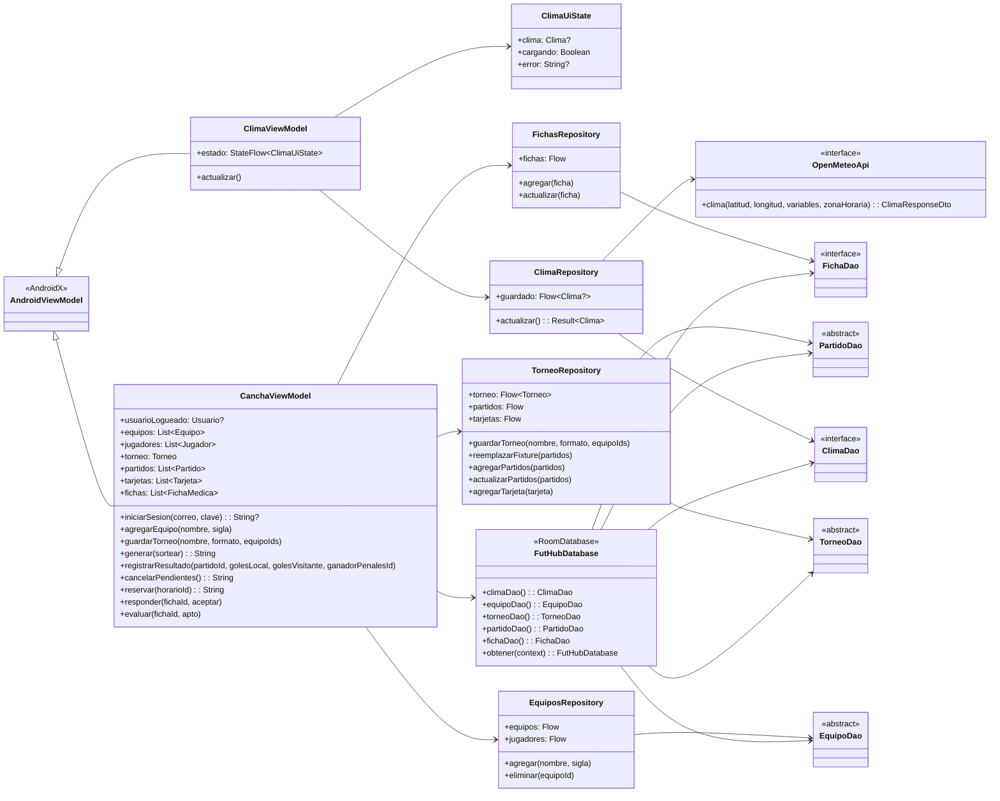
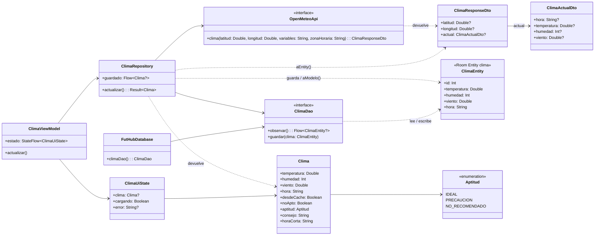
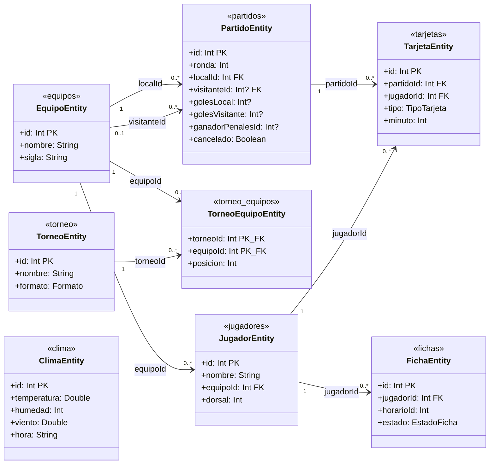

# FutHub / CanchaBolivia — Diagramas de clases de la implementación actual

**Código revisado:** `oscar10117/futhub`, rama `LEANDRO`, commit `0da818529c1d438277bd0cdb14409f9ba6cde24a` (21 de octubre de 2026, hora de Bolivia). **Implementación:** Open-Meteo + Retrofit, DTO, funciones mapper, Room versión 3, ViewModels y repositorios. 

> Estos diagramas describen las clases y relaciones que realmente existen en el código. El diagrama anterior de `modelodiagrama/ModeloDiagrama.kt` es un modelo documental diferente; no equivale al modelo de ejecución actual.

## 1. Diagrama de clases: arquitectura de la aplicación

## 2. Diagrama de clases: API, DTO, mapper y caché del clima

**Mapper real:** `mapper/ClimaMapper.kt` **no declara una clase** `ClimaMapper`. Declara dos funciones de extensión a nivel de archivo: `ClimaResponseDto.aEntity(): ClimaEntity?` y `ClimaEntity.aModelo(desdeCache: Boolean): Clima`. Por eso se representan mediante flechas etiquetadas, sin inventar una clase. La consulta usa Open-Meteo para La Paz; una lectura válida se guarda en `clima` (fila `id = 1`) y se puede recuperar sin internet.

## 3. Diagrama de clases y relaciones persistidas: Room (v3)

Todas las relaciones mostradas entre entidades son **claves foráneas declaradas con `onDelete = CASCADE`**. `TorneoEquipoEntity` es la tabla puente y su PK compuesta es `(torneoId, equipoId)`. `TorneoEntity` y `ClimaEntity` usan `id = 1`. `FichaEntity.horarioId` **no** es FK: los horarios son una lista fija en `CanchaViewModel`. `PartidoEntity` **no** tiene `torneoId` (actualmente la app maneja un único torneo).

## 4. Relación entre entidades Room y modelos del dominio

| Archivo de mapeo real | Conversiones declaradas |
|---|---|
| `ClimaMapper.kt` | `ClimaResponseDto → ClimaEntity?`, `ClimaEntity → Clima` |
| `EquipoMapper.kt` | `EquipoEntity → Equipo`, `JugadorEntity → Jugador` |
| `TorneoMapper.kt` | `TorneoEntity → Torneo`, `PartidoEntity ↔ Partido`, `TarjetaEntity ↔ Tarjeta` |
| `FichaMapper.kt` | `FichaEntity ↔ FichaMedica` |

**Otros modelos reales de `Modelo.kt`:** `Usuario`, `Equipo`, `Jugador`, `HorarioMedico`, `FichaMedica`, `Torneo`, `Partido`, `Tarjeta`, `Posicion`, `MotorTorneo`, y enumeraciones `Rol`, `Formato`, `EstadoFicha`, `TipoTarjeta`. El modelo de clima declara `Clima` y `Aptitud`.

**DAOs reales:** `ClimaDao`, `EquipoDao`, `TorneoDao`, `PartidoDao`, `FichaDao`. **Repositorios reales:** `ClimaRepository`, `EquiposRepository`, `TorneoRepository`, `FichasRepository`. **ViewModels reales:** `ClimaViewModel`, `CanchaViewModel`.

**Migraciones existentes:** `1→2` agrega equipos y jugadores, `2→3` agrega torneo, inscripciones, partidos, tarjetas y fichas. El archivo `futhub.db` es una base local de cada dispositivo; no sincroniza entre dispositivos.

**Límite de verificación:** documentación elaborada contrastando el código fuente de la rama `LEANDRO`. No constituye confirmación de compilación o ejecución en emulador.
